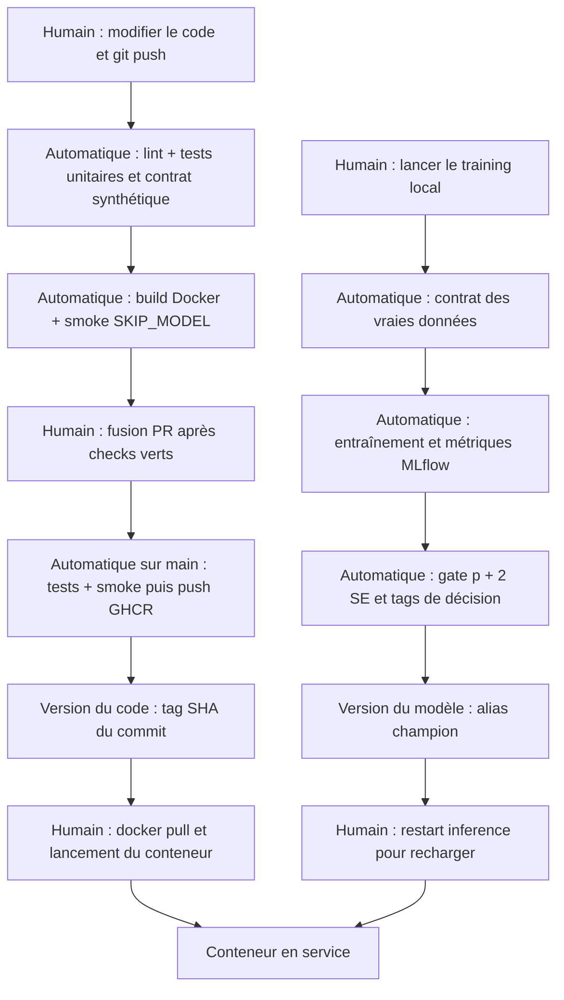

# Lab 5 — CI/CD avec GitHub Actions

## Réalisation

Le projet conserve les labs 1 à 4 et ajoute une pipeline `test → smoke → push`, un contrat de données et une règle de promotion MLflow. Les entraînements s'exécutent localement, jamais dans la CI cloud. Les poids restent dans MLflow ; l'image publiée sur GHCR contient le code et ses dépendances.

Fichiers principaux : [workflow](../.github/workflows/ci.yml), [tests](../tests), [contrat](../src/food11/validate_data.py), [promotion](../src/food11/promote.py), [préparation nettoyée](../scripts/prepare_lab5_data.py), [deux entraînements](../scripts/run_lab5_candidates.py).

## Données réellement contrôlées

Le mini-dataset des anciens labs contient **43 copies inter-splits**, détectées par les empreintes MD5. Les autres contrôles passent. Les anciens fichiers DVC sont conservés.

Une copie sous `data/lab5/food11_processed_mini` garde le split d'entraînement et retire les doublons des splits suivants, dans l'ordre training, validation, evaluation. Cette copie passe les cinq contrôles. L'incumbent est réévalué sur le holdout nettoyé avant de comparer les candidats : on ne réutilise pas son ancien score mesuré sur le jeu contenant des doublons.

- [Rapport du dataset original](../reports/lab5/data-contract.json).
- [Liste exacte des copies retirées](../reports/lab5/data-cleanup.json).
- [Contrat du dataset nettoyé](../reports/lab5/data-contract-clean.json).
- [Doublon volontaire détecté](../reports/lab5/duplicate-demo.json).
- [Équivalence exacte avec le prétraitement du lab 4](../reports/lab5/preprocessing.json).

## Reproduire

Depuis la racine du dépôt, avec Docker Desktop ouvert :

```powershell
uv sync --frozen
uv run ruff check src tests
uv run pytest -q
uv run python src/food11/validate_data.py data/food11_processed_mini
# La commande précédente échoue : les 43 doublons sont réels.
# À exécuter une seule fois pour créer une copie neuve :
uv run python -m scripts.prepare_lab5_data
uv run python src/food11/validate_data.py data/lab5/food11_processed_mini
docker compose up -d --wait mlflow
uv run python -m scripts.run_lab5_candidates
```

Le script d'entraînement requiert le modèle `food11@champion` déjà initialisé au lab 4. Il reprend les runs terminés du groupe `lab5-2026-11-02` plutôt que de réentraîner inutilement. Le script de préparation refuse d'écraser un dossier existant.

Pour appliquer le gate à une version enregistrée :

```powershell
uv run python src/food11/promote.py --tracking-uri http://127.0.0.1:5500 --version NUMERO --dry-run
uv run python src/food11/promote.py --tracking-uri http://127.0.0.1:5500 --version NUMERO
```

La taille du test est lue dans les paramètres MLflow. Une métrique manquante, un run non terminé, un jeu de données différent ou des tailles incohérentes bloquent la promotion. Une promotion ne recharge pas un processus API déjà démarré : utiliser `docker compose restart inference`.

## Question 1 — Pourquoi ne pas charger le vrai modèle dans les tests unitaires ?

Un serveur MLflow arrêté, un problème réseau, des identifiants expirés ou un artefact supprimé peuvent casser le test alors que le code est correct. Le téléchargement ralentit aussi les tests et un alias modifié change leur résultat sans changement de code. Avec `SKIP_MODEL=1`, aucun import Torch/MLflow ni téléchargement de poids n'est nécessaire. `/health` répond 200 et `/predict` répond 503 tant qu'aucun modèle n'a été injecté.

## Question 2 — Ce que prouve le faux modèle

Le test vérifie le décodage d'un vrai JPEG, le prétraitement vers un tableau float32 de forme `(1, 3, 224, 224)`, l'appel au modèle, l'association de la classe et le JSON HTTP. Il vérifie aussi que la confiance vaut environ 0,90.

Notre vrai réseau retourne des **logits** : le faux modèle retourne donc les logarithmes des probabilités afin que le softmax produise 0,90. Donner directement 0,90 comme logit ne signifierait pas 90 % de confiance. Ce test ne mesure ni l'accuracy, ni la généralisation, ni la disponibilité du registre réel.

## Question 3 — Doublon train/test

Le contrôle `cross_split_duplicates` détecte l'identité des octets entre deux splits. L'exercice copie une image de training/Bread vers evaluation/Bread dans le dataset nettoyé, constate un code de sortie 1, puis retire cette seule copie dans un bloc `finally`.

Une image corrompue provoque généralement une erreur visible. Un doublon train/test peut au contraire donner un score trompeusement élevé sans faire planter l'entraînement : l'évaluation n'est plus indépendante.

## Question 4 — Où contrôler les vraies données ?

1. Après préparation ou `dvc pull`, avant l'entraînement, sur une machine qui possède les données. `train.py` applique maintenant ce contrôle avant de créer les loaders.
2. Avant de publier une nouvelle version DVC ou dans un job sur runner interne disposant du remote DVC, avant l'étape d'entraînement/promotion.

La CI cloud vérifie la logique du validateur sur un petit dataset synthétique temporaire. Elle ne prétend pas avoir téléchargé ou contrôlé le dataset DVC complet.

## Question 5 — Dépendance entre jobs

Avec `needs: test`, un échec de test fait ignorer `smoke`, puis `push`. Sans cette dépendance, le build pourrait démarrer en parallèle et consommer des ressources malgré des tests rouges. Le job `push` dépend à son tour de `smoke` et ne publie que sur `main`, hors événements de pull request.

## Question 6 — Durées et cache

Deux pushes successifs sur la même branche :
| Exécution | Durée totale | Installation uv | Build Docker |
| --- | ---: | ---: | ---: |
| [Première](https://github.com/Ghandour-Ali/mlops-lab-1/actions/runs/41471768952) | 242 s (4 min 02) | 4 s | 183 s |
| [Commit vide suivant](https://github.com/Ghandour-Ali/mlops-lab-1/actions/runs/41472645183) | 103 s (1 min 43) | 4 s | 51 s |

Le gain observé concerne surtout Docker ; aucune accélération mesurée pour uv sur ces deux exécutions. [Mesures détaillées](../reports/lab5/ci-comparison.json).

Le cache uv réutilise les téléchargements et le cache BuildKit réutilise les couches Docker. Le scope `food11-api` est partagé entre le build du smoke et celui de publication. Un runner reste une VM neuve : le cache est une optimisation, pas un disque persistant garanti. Les durées observées incluent aussi la préparation des runners et le transfert du cache.

## Question 7 — Pourquoi le SHA plutôt que latest ?

Le tag contient le SHA complet du commit, ce qui permet d'identifier le code à l'origine de l'image et de revenir à une version précise. Avec `latest`, une machine qui a téléchargé l'image lundi peut conserver l'ancien cache tandis qu'une autre la télécharge mardi après un nouveau push : même nom, code différent. Un SHA dans le nom reste techniquement un tag remplaçable ; pour un verrouillage strict, on peut déployer le digest de l'image.

## Question 8 — Permissions explicites

Le workflow dispose de `contents: read`. Seul le job de publication reçoit `packages: write` pour GHCR ; il n'a pas besoin d'écrire dans le dépôt. Le jeton éphémère `GITHUB_TOKEN` est injecté par GitHub, sans secret personnel commité. Un step compromis avec des droits excessifs pourrait pousser du code, modifier une release ou publier des artefacts malveillants selon les droits accordés.

## Question 9 — Protection de main et PR volontairement rouge

La [PR #2](https://github.com/Ghandour-Ali/mlops-lab-1/pull/2) introduit volontairement une mauvaise catégorie : le job test échoue, smoke est ignoré et GitHub renvoie `mergeable_state: blocked`. La fusion n'est donc pas autorisée, même pour l'administrateur. Après restauration de la fonction, les checks test et smoke passent ; la PR est fusionnée au commit `07f855f790aa4427a5c26a30fbd783d780a5f90c`. [Preuve rouge, verte et fusion](../reports/lab5/protection-demo.json), [configuration de protection](../reports/lab5/branch-protection.json).

La règle exige une pull request et les contrôles `test` et `smoke`, avec une branche à jour. Elle s'applique aussi à l'administrateur. Aucun deuxième approbateur n'est imposé pour ce dépôt individuel. L'équipe dispose ainsi d'un contrôle central vérifiable sur le commit proposé, plutôt que d'une simple déclaration « ça passe sur mon ordinateur ».

## Question 10 — Décisions du quality gate

On calcule `se = sqrt(p × (1 − p) / n)` puis le seuil `p + 2 × se`. Un candidat qui atteint ou dépasse ce seuil reçoit l'alias `champion` ; sinon il reçoit `challenger`, sans déplacer le champion. Les décisions et valeurs numériques sont enregistrées dans les tags `gate.*` de chaque version.

| Version | Learning rate | Accuracy test | Décision | Run |
| --- | ---: | ---: | --- | --- |
| 4 | 1e-06 | 14.1232 % | challenger | `3eff99840c6d4c63af1bd4fce15f0b94` |
| 5 | 0.0001 | 83.3175 % | challenger | `2ff2f75a29d84e9a8ac66119c7c21b95` |

Champion : version **3**, accuracy **83,3175 %**, sur **1 055** images.
`se = 0,01147815` ; `2 × se = 0,02295631`, soit **2,2956 points de pourcentage**.
Le seuil est **85,6132 %**. Aucun candidat ne le franchit ; champion reste sur v3. L'alias unique challenger pointe finalement vers v5 ; les tags de v4 conservent sa décision antérieure. [Résultats complets](../reports/lab5/promotion-results.json), [runs, historiques et tags](../reports/lab5/mlflow-evidence.json).

Les deux candidats sont réellement entraînés pendant cinq époques sur CPU, avec batch size 32 et seed 42. Le premier utilise un learning rate de 0,000001, le second 0,0001. La version de référence contient les mêmes poids qu'avant, réévalués et réenregistrés avec les métadonnées du holdout nettoyé.

Cette règle applique la formule pédagogique du lab. Deux erreurs standards ne constituent pas, à elles seules, un test statistique apparié entre modèles ; réutiliser le test pour plusieurs décisions de promotion peut aussi introduire un biais de sélection. Une évaluation finale indépendante reste souhaitable.

## Question 11 — Automatiser la promotion après entraînement

- Faire suivre le training par le validateur/gate sur un runner auto-hébergé capable de joindre MLflow, en sérialisant les promotions.
- Héberger MLflow sur un service accessible aux jobs (par exemple DagsHub ou un serveur protégé), injecter les identifiants via les secrets du workflow et déclencher la promotion après un training terminé.

Le gate est déjà appelé par notre script local après chaque candidat. Aucun entraînement réel ni accès à MLflow local n'est demandé aux runners GitHub cloud.

## Question 12 — Pipeline et décisions de versions



La publication de l'image est automatisée. Son déploiement sur le poste et le redémarrage de l'API restent manuels. Le SHA Git et l'alias MLflow sont deux décisions indépendantes : changer le modèle ne nécessite pas de reconstruire l'image.


## Image publiée et vérification locale

La [pipeline sur main](https://github.com/Ghandour-Ali/mlops-lab-1/actions/runs/41473644808) a exécuté les trois jobs avec succès. Le package est accessible publiquement : le manifeste répond sans identifiants (HTTP 200).

```powershell
docker pull ghcr.io/ghandour-ali/mlops-lab-1:40ca3b342bf2d56d9be785fb44f7793f47542141
docker run --rm -p 127.0.0.1:5800:8000 -e SKIP_MODEL=1 ghcr.io/ghandour-ali/mlops-lab-1:40ca3b342bf2d56d9be785fb44f7793f47542141
```

Ce tag est la première publication vérifiée du lab. Les commits suivants sur main produisent leur propre tag SHA. Le pull a été effectué sur le poste : `/health` répond 200 et `/predict` répond 503 sans modèle, conformément au mode de smoke. [Digest et preuve](../reports/lab5/ghcr-pull.json).

Pour tester une photo avec le vrai champion et l'interface du lab 4 :

```powershell
docker compose up -d --build --wait
```

Ouvrir http://localhost:8501 ; MLflow est sur http://localhost:5500, expérience `food11-lab5`. Les adresses localhost ne sont accessibles que sur la machine qui héberge Compose. [Vérification de la stack et prédiction réelle](../reports/lab5/real-serving.json).

## Sources

- [GitHub : protection des branches](https://docs.github.com/en/rest/branches/branch-protection).
- [GitHub : Container Registry et authentification](https://docs.github.com/en/packages/working-with-a-github-packages-registry/working-with-the-container-registry).
- [uv dans GitHub Actions](https://docs.astral.sh/uv/guides/integration/github/).
